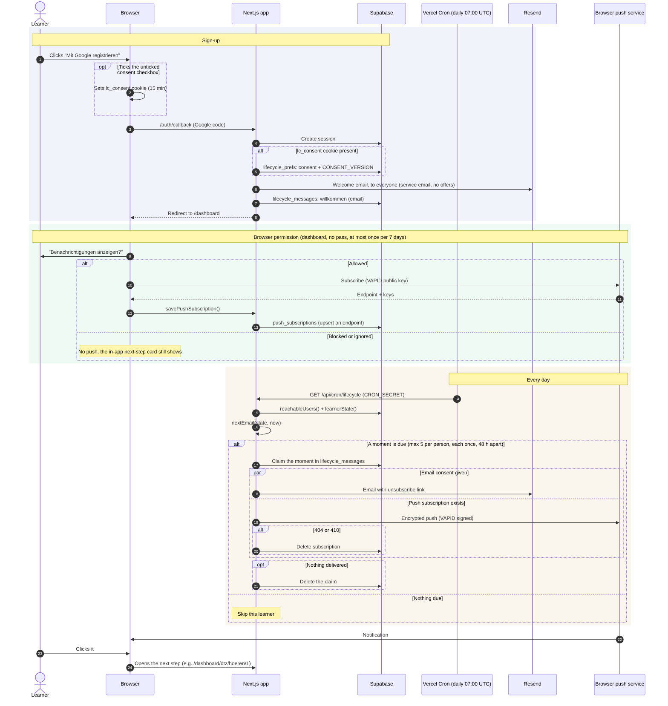
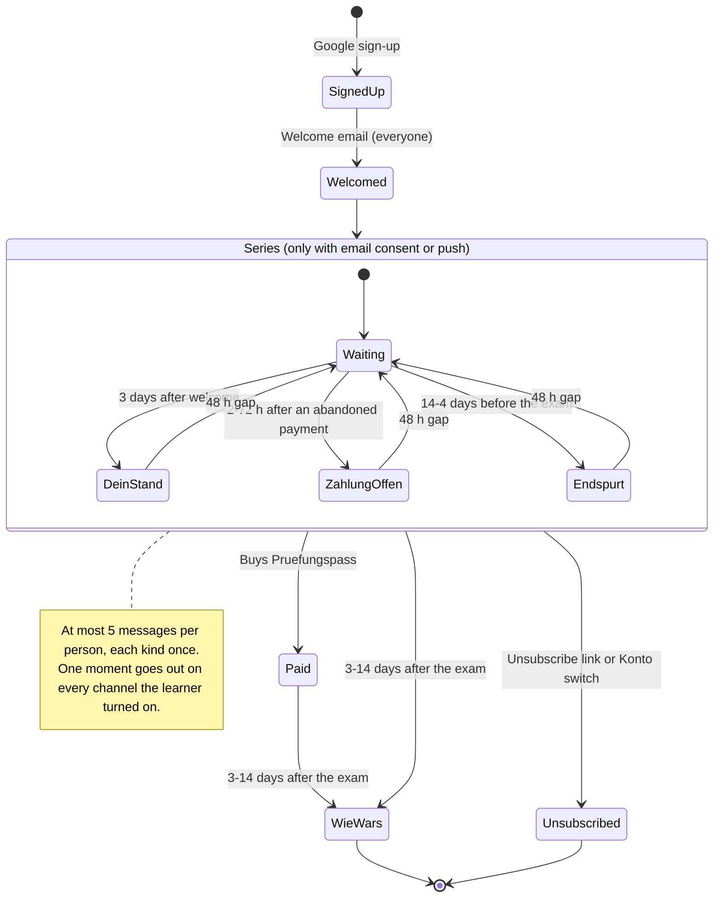

# Lifecycle messages (emails + browser push)

Status 2026-10-27. Rules live in `lib/lifecycle/rules.ts`. The welcome email at sign-up and the email channel in the cron are planned and not wired yet; push is built.

## Sequence

## Learner states

